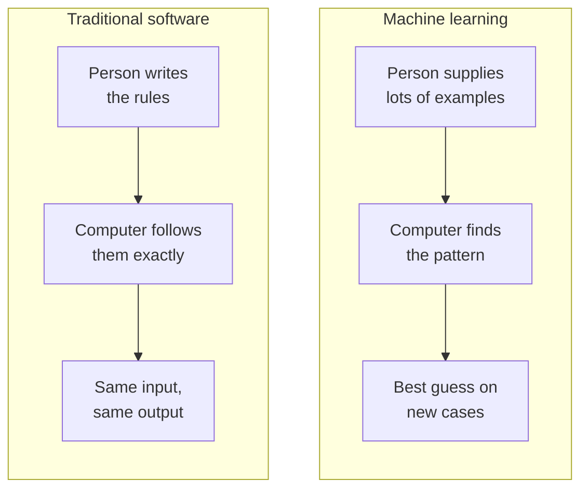

## Why this matters

Almost every owner you meet will have a fuzzy, slightly worried picture of "AI". If you can explain clearly what it is, where it came from and which part of it you are actually selling, you sound like the expert in the room. That clarity also stops you from proposing the wrong technology, which is the fastest way to lose a client's trust.

## Core explanation

### AI is an umbrella, not a product

**Artificial intelligence (AI)** is a broad label for any computer system that does something we would normally say needs human thinking: recognising a face, understanding a sentence, planning a route, spotting a fraudulent payment.

Think of the word "construction". It covers groundworks, bricklaying, electrics, plumbing and plastering. Nobody hires "construction". They hire a trade. AI is the same. When a client says "we want AI", your first job is to work out which trade they actually need.

The diagram below shows how the main terms fit inside each other.

<AINestingFigure />

### Rules versus learning

Traditional software follows **rules that a person wrote**: "if an invoice is more than 30 days overdue, send reminder B". It is exact, cheap and predictable, like a method statement that is followed to the letter. A lot of what gets marketed as "AI" is really this: plain automation.

**Machine learning (ML)** turns this around. Instead of writing the rules, you show the system thousands of examples and let it work out the pattern for itself. Show it 50,000 emails already labelled "spam" or "not spam", and it learns to sort new ones. It is the difference between handing an apprentice a written procedure and letting them learn by watching a hundred jobs.

That last box matters. Machine learning makes **best guesses**. It is usually right, sometimes wrong, and it cannot always tell you why. That is a feature when the rules are too complicated to write down, such as recognising handwriting. It is a risk when you need certainty, such as calculating VAT.

### Deep learning

**Deep learning** is machine learning using very large "neural networks": layers of simple maths units, loosely inspired by the brain, stacked many layers deep. From about 2012 onwards, deep learning produced big jumps in recognising images, transcribing speech and translating languages. Your phone unlocking with your face and your car reading speed-limit signs are both deep learning.

### Large language models (LLMs)

A **large language model** is a deep-learning model trained on an enormous amount of text (books, websites, code, articles) with one deceptively simple job: **predict the next word**. Do that billions of times across most of the written internet and something surprising appears. To predict well, the model has to pick up grammar, facts, writing styles, and even a working grasp of reasoning.

"Large" refers both to the size of the model, which has billions of adjustable settings called **parameters**, and to the size of its training data. The chat assistants your clients have heard of are products built on LLMs:

| Product | Company | Built on |
|---|---|---|
| ChatGPT | OpenAI | OpenAI's GPT models |
| Claude | Anthropic | Anthropic's Claude models |
| Gemini | Google | Google's Gemini models |
| Microsoft Copilot | Microsoft | Models from OpenAI and other providers, connected to Microsoft 365 |

Note the difference between the **product** (the app you type into) and the **model** (the engine inside it). Companies swap and upgrade models inside the same product regularly. That is one reason this course marks tool details 🔄.

LLMs are a type of **generative AI**: AI that creates new content (text, images, audio, video) rather than just sorting or scoring existing content. Image generators and AI voice tools are generative AI too. [Lesson 1.2](/lesson/1-2) explains how one general model is trained and then specialised into the different tools you will meet, and lesson 1.4 covers what each kind can do.

### What an LLM is not

This is where most client misunderstandings come from:

- **It is not a database.** It doesn't look facts up in a table. It produces text that is *statistically likely* to be right. Usually it is right. Sometimes it confidently invents things. This is called **hallucination**, and lesson 1.3 deals with it properly.
- **It is not a search engine**, although many assistants can now run a web search and read the results before answering.
- **It does not automatically learn your business.** It only knows what was in its training data and what you put in front of it in the conversation. Making it "know" a client's price list or procedures is a design job, covered in lessons 1.2, 3.2 and 8.4.
- **It is not thinking the way a person does.** It has no goals, memory of last week or common sense beyond what its patterns provide. Treat it like a fast, well-read junior who never gets tired, needs clear instructions and must have their work checked.

<Callout type="trades">
A builder already knows this pattern. A **method statement** is traditional software: follow the steps exactly. An **experienced site manager** is closer to machine learning: they have seen hundreds of jobs and can spot a problem nobody wrote a rule for, but they can still be wrong. An **LLM** is like a site manager who has read every trade manual ever printed but has never stood on your site. They know a lot, they write well, and they still need to be told the specifics of *this* job.
</Callout>

### Which one does the problem need?

| Type | How it works | Small-business example | Typical tools |
|---|---|---|---|
| Plain automation (not AI) | Fixed rules a person sets | Send a review request 3 days after an invoice is paid | Zapier, Make, built-in software features |
| Classic machine learning | Learns patterns from lots of labelled data | Bank-feed categorisation in accounting software; spam filters | Usually built into existing software |
| LLM / generative AI | Predicts language; drafts, summarises, extracts, classifies text | Draft a reply to a website enquiry; summarise a site meeting | Claude, ChatGPT, Gemini, Copilot |

Most of the work you will sell to small UK businesses is **plain automation with an LLM step in the middle**: a form arrives (automation), an LLM drafts the reply (AI), and a person approves it (human). Module 4 teaches exactly that pattern.

## Worked example: Brennan & Dawes Electrical

*Fictional business; figures are an illustrative example.*

**Brennan & Dawes Electrical** is an eight-person domestic and light-commercial electrical contractor in Croydon. The owner, Kieran Brennan, asked for "an AI system" after a trade show. In the discovery chat he listed three frustrations:

1. **Supplier invoices** arrive by email from four wholesalers and have to be saved into the right job folder.
2. He wants to **predict which quotes will be won** so he can chase the likely ones first.
3. His office manager, Priya, spends a lot of time **replying to website enquiries** and writing quote cover letters.

Sorting these by technology type showed:

- **Invoices:** no AI needed. The sender and subject line follow fixed patterns, so a simple rules-based automation can file them. Build time: about 2 hours.
- **Quote prediction:** this is a machine-learning problem, but the firm sends about 300 quotes a year. That is too little data to train anything reliable. The honest advice was: not yet. Track won and lost reasons in a spreadsheet for 12 months first.
- **Enquiries and cover letters:** a classic LLM job. Priya pastes the enquiry and her notes into an AI assistant that has been given the firm's tone of voice and standard terms, then edits the draft before sending.

**Outcome (illustrative):** Priya handles about 40 enquiries a week. Drafting dropped from roughly 15 minutes to about 4 minutes each, including her checking time. That saves around 7 hours a week. At £18 an hour, that is roughly £126 a week, and about £5,800 a year over 46 working weeks, against a £20-a-month assistant subscription. Kieran also trusted the recommendation more *because* he was told that one of his three ideas wasn't ready for AI.

<Callout type="money">
Being able to say "you don't need AI for that" is a sales asset. It makes your "you *do* need AI for this" believable.
</Callout>

## Tools

<Callout type="changes" title="Changes fast: prices checked 15 November 2026">
UK prices for individual plans often differ between web checkout, app stores and annual billing, and promotions come and go. Always check the provider's own pricing page before quoting a client.
</Callout>

These are the four general-purpose AI assistants your clients are most likely to have heard of. Lesson 2.1 compares them properly, including business plans and data settings.

| Tool | What it does | Approximate UK cost 🔄 |
|---|---|---|
| **ChatGPT** (OpenAI) | General assistant: writing, analysis, images, voice, web search | Free tier; Plus about £20/month |
| **Claude** (Anthropic) | General assistant, strong at long documents, careful writing and analysis | Free tier; Pro about £18/month billed monthly, less on annual billing |
| **Gemini** (Google) | General assistant, tightly linked to Gmail, Docs and Drive | Free tier; Google AI Pro £18.99/month |
| **Microsoft Copilot** | Assistant inside Windows, Edge and Microsoft 365 apps (Outlook, Word, Excel, Teams) | Free consumer app; Microsoft 365 Copilot Business add-on about £16.10/user/month ex VAT on annual commitment |

<Callout type="warning">
Free and personal plans are fine for learning. For client work involving customer or staff data, use business plans with the right data settings. Modules 2 and 9 explain why.
</Callout>

## Hands-on exercise

<Exercise minutes={8} title="Sort the tasks, then test an explanation">

**Part 1: sort (4 minutes).** For each task below, decide whether it needs **plain automation**, **machine learning** or an **LLM**, or whether it is **not a technology problem at all**. Jot your answers down before opening the answer key.

1. Text a customer the day before their appointment
2. Turn a rambling voice note from site into a tidy list of snags
3. Flag bank transactions that look like fraud
4. Reply to "do you cover Sutton and how soon can you come?" in the firm's tone of voice
5. Copy new web-form enquiries into a spreadsheet
6. Decide whether to take on a second van driver
7. Pull the supplier name, date and total from 200 scanned delivery notes
8. Write five Facebook post ideas for a bathroom-fitting business

**Part 2: test (4 minutes).** Open any free AI assistant (Claude, ChatGPT or Gemini) and paste in:

<PromptBox text="Explain the difference between AI, machine learning and a large language model to a plumber who has never used ChatGPT. Use a plumbing analogy, keep it under 100 words, and avoid jargon." />

Read the answer critically. Is it accurate? Would a plumber get it? Rewrite it in your own words as three sentences you would actually say in a meeting.

**Expected result:** a sorted list that matches the key at least 6 times out of 8, and a three-sentence explanation of your own that you are comfortable saying out loud.

Answer key

1. **Plain automation:** a scheduled text from the booking system. No AI needed.
2. **LLM:** a transcription tool turns speech into text, then an LLM summarises it into a list.
3. **Machine learning:** your bank already does this with models trained on millions of transactions.
4. **LLM:** drafting a natural reply in a set tone. A person should approve it at first.
5. **Plain automation:** a Zapier or Make "form → spreadsheet" step.
6. **Not a technology problem:** it is a business judgement. AI can help you think it through, but it can't make the decision.
7. **LLM, or a specialist document-AI tool:** extracting structured data from documents. Lesson 8.7 builds this.
8. **LLM:** generating ideas and drafts, with a human picking and editing.

</Exercise>

## Common mistakes

1. **Calling every automation "AI".** Rules-based automations are valuable on their own. Labelling them AI over-promises and confuses clients when they behave rigidly.
2. **Treating LLM output as fact.** An LLM predicts plausible text. Anything that matters (prices, regulations, measurements, legal wording) needs a human check or a trusted source.
3. **Assuming the client needs a "custom AI model".** Almost no small business needs to train its own model. Off-the-shelf assistants with good instructions and the right documents attached cover the vast majority of needs, at a fraction of the cost.
4. **Mixing up the product and the model.** "ChatGPT" is an app; "GPT" models are the engines inside it. Knowing the difference helps when a client says "we tried AI and it was rubbish". They may have used an old free model.
5. **Promising that "it learns your business".** By default it doesn't. It learns only through what you give it. Be precise about how it will get the client's information.

## Key takeaways

- **AI** is the umbrella. **Machine learning** learns from examples. **Deep learning** uses large neural networks. **LLMs** are deep-learning models trained on text to predict the next word.
- Traditional software follows rules exactly. Machine learning and LLMs make **best guesses**, which is powerful but needs checking.
- The assistants clients know (ChatGPT, Claude, Gemini, Copilot) are **products built on LLMs**, and their models and prices change often.
- Most small-business wins are **plain automation with an LLM step and a human check**, not custom AI.
- Telling a client where they *don't* need AI builds the trust that wins the work where they do.
