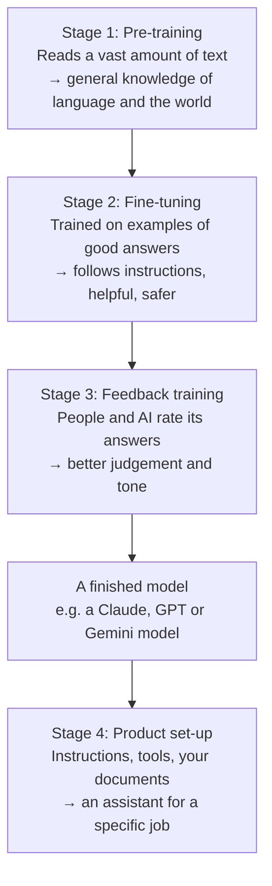

## Why this matters

The questions clients ask most ("Will it know our prices?", "Is it learning from our data?", "Why did it forget what I said earlier?") are all answered by this lesson. Get these mechanics right and your designs work first time, your quotes for API costs are sensible, and you can answer data questions honestly instead of guessing.

## Core explanation

### Tokens: how a model reads

An LLM doesn't read words or letters. It reads **tokens**: chunks of text that are often a whole short word, sometimes part of a longer one, plus punctuation and spaces. "Plasterboard" might be split into "Plaster" and "board". "The" is one token.

A useful rule of thumb for English:

| Text | Words | Tokens (approx.) |
|---|---|---|
| Rule of thumb | 3 words | 4 tokens |
| A typical customer email | 200 | 270 |
| A two-page quote with terms | 1,000 | 1,300 |
| A 40-page staff handbook | 16,000 | 21,000 |
| A full novel | 90,000 | 120,000 |

Tokens matter for three practical reasons:

1. **Cost.** When you connect AI into automations through an **API** (a way for software to talk to software, covered in lesson 4.1), you pay per token, separately for what goes in (input) and what comes out (output).
2. **Limits.** Every model has a maximum number of tokens it can handle at once (the context window, below).
3. **Odd behaviour.** Because the model sees chunks rather than letters, it can be surprisingly bad at letter-level tasks such as counting the letters in a word or reversing a postcode.

### How an answer is produced

The model writes its answer **one token at a time**. At each step it calculates which tokens could come next, and how likely each one is, then picks one. It then repeats, using everything so far, until the answer is finished.

There is a small amount of controlled randomness in that choice. That is why the same question can produce slightly different answers each time. It is useful for creative work, but it is one reason you test an AI step many times before trusting it in a client's automation (lesson 4.4).

### How a general model becomes a specialist

This is where generative AI tools get their different personalities and skills. A model is built in stages, much like a tradesperson:

1. **Pre-training: general education.** The model reads a huge amount of text and learns to predict the next token. The result is a **base model**. It knows a lot, but it simply continues text: ask it a question and it might reply with three more questions.
2. **Fine-tuning: the apprenticeship.** The base model is trained further on many thousands of example conversations showing good, helpful, safe answers. This turns it into something that follows instructions.
3. **Feedback training.** People (and increasingly other AI models) compare pairs of answers and say which is better. The model is nudged towards the preferred style. You may see this called **RLHF**, short for "reinforcement learning from human feedback". This stage is a big part of why ChatGPT, Claude and Gemini each *feel* different.
4. **Product set-up: the site induction.** The finished model is wrapped in a product with hidden instructions (a **system prompt**), tools such as web search or file reading, and sometimes access to your documents. This is the layer *you* will mostly work in.

Companies also make **specialist variants** by changing the training mix:

- **Small, fast models:** cheaper and quicker, good for simple sorting and short drafts in automations.
- **Reasoning models**, often shown as "thinking" or "extended thinking": trained to work through a problem step by step before answering. They are slower and dearer, and better at maths, planning and tricky analysis.
- **Coding models:** trained heavily on code.
- **Different kinds of generative AI for different media:** image generators, speech-to-text and text-to-speech use different model designs, trained on images or audio rather than text. Lesson 1.4 covers what each can do.

<Callout type="trades">
Think of an electrician. **Pre-training** is school and general knowledge. **Fine-tuning** is the apprenticeship that turns knowledge into a working trade. **Feedback training** is years of a supervisor saying "do it like this, not like that". **Product set-up** is the site induction: *this* client, *these* drawings, *these* rules. You rarely retrain the electrician. You give them a better induction. Most of your AI work is the same.
</Callout>

### The training cutoff

A model's training stops on a particular date, its **training cutoff**. It knows nothing that happened afterwards unless the product gives it a **web search** tool or you paste the information in. Ask about this month's interest rate or a regulation change from last week, and a model without search will either say it doesn't know or, worse, guess.

### The context window: the desk it works at

The **context window** is everything the model can "see" at once while producing an answer: the hidden instructions, any documents you attached, the whole conversation so far, *and* the answer it is writing. It is measured in tokens.

<ContextWindowFigure />

In late 2026 the leading models advertise context windows of roughly **200,000 to 1,000,000 tokens** 🔄, which is roughly 150,000 to 750,000 words. That is big enough for most small-business document sets. Three cautions:

- **Big is not the same as perfect.** Models are less reliable at picking details out of the *middle* of a very long context. Twenty focused pages beat 2,000 unfocused ones.
- **When a long chat fills the desk,** products quietly drop or summarise older parts. That is why an assistant "forgets" what you agreed an hour ago. Start fresh chats for fresh tasks.
- **Every token on the desk costs money** when you use the API. Sending a 300-page manual with every enquiry is slow and expensive.

### Training vs. your data: getting a client's knowledge in

A model's training contains general knowledge, not the client's price list. There are three ways to get business knowledge in front of it:

| Method | How it works | Good for | Effort |
|---|---|---|---|
| **Put it in the context** | Attach files, or save them in a project or custom assistant, so they are on the desk every time | Handbooks, price lists, tone-of-voice guides, templates under a few hundred pages | Low: minutes to hours |
| **Retrieval (RAG)** | Store many documents in a searchable library; for each question, the system finds the most relevant passages and puts *only those* on the desk | Large or frequently changing document sets: hundreds of procedures, job histories | Medium: lesson 8.4 builds one |
| **Fine-tuning** | Train the model further on hundreds or thousands of the client's own examples | Changing *style or behaviour* at large scale, not adding facts | High, and rarely worth it for a small business |

**RAG** stands for "retrieval-augmented generation". It sounds technical, but it is simply *look it up, then answer*.

### "Is it learning from our data?"

Clients ask this constantly. Give a precise answer:

- **Not in real time.** A model does not get smarter about the business during a chat. When the chat ends, the desk is cleared.
- **"Memory" features** in some products save short notes about you, such as "prefers British English", and put them back on the desk next time. That is note-taking, not learning.
- **Future training is a settings and contract question.** On many *personal* plans (free and individual paid tiers), providers may use your chats to train future models unless you switch it off in the privacy settings. *Business* plans and API access are typically excluded from training by default 🔄. Check the provider's current terms, and use business plans for client data. Lesson 2.1 compares the settings and Module 9 covers the legal side.

## Worked example: Ashworth Lettings

*Fictional business; figures are an illustrative example.*

**Ashworth Lettings** is a six-person letting and property-management agency in Leeds that manages 120 properties. Its manager, Dana Ashworth, wanted "an AI that knows everything about our business" so staff stop interrupting her with questions like "what's our process for a deposit dispute?". Another supplier had quoted £8,000 to "train a custom AI on our data".

Working through it with the ideas from this lesson:

1. **What knowledge is needed?** The 38-page procedures handbook, the fee schedule and 12 template letters. That is about 19,000 words, or **roughly 25,000 tokens**, which fits comfortably in any current model's context window.
2. **What changes daily?** Property and tenant details live in the agency's property-management software and change constantly. They should *not* be pasted into an assistant. They stay in the system of record and are linked to later, if at all.
3. **Fine-tuning?** Not needed. The problem is *facts and procedures*, which context handles. Fine-tuning changes style and behaviour, not knowledge.
4. **Data:** the handbook contains no tenant personal data, but staff questions might. So a business-tier assistant plan was chosen, with training on customer data off by default, plus a one-line staff rule: *no tenant names or contact details in prompts*.

**Build:** a shared project, or custom assistant, holding the handbook, fee schedule and templates, with instructions to answer only from those documents, quote the section number, and say "not covered in the handbook: ask Dana" when unsure. Set-up took about half a day, including testing it with 30 real past questions.

**Outcome (illustrative):** staff asked around 25 procedural questions a day. Look-ups dropped from about 5–6 minutes (finding Dana, or searching the handbook) to about 1 minute. That frees roughly 1.5–2 hours of staff and manager time a day, for a few business-plan seats costing tens of pounds a month instead of £8,000 up front. Because every answer cites the handbook section, staff could check anything that looked wrong.

<Callout type="money">
"You don't need a custom-trained AI; you need your documents organised and attached properly" saves the client thousands and positions you as the honest expert. Charge for the organising and the testing: that is where the value is.
</Callout>

## Tools

<Callout type="changes" title="Changes fast: checked 15 November 2026">
Context-window sizes, plan features and API prices change several times a year, and model names change with them. Check the provider's own pages before quoting a client.
</Callout>

| Tool | What it does | Approximate UK cost 🔄 |
|---|---|---|
| **OpenAI Tokenizer** (platform.openai.com/tokenizer) | Paste any text to see how it splits into tokens | Free |
| **Claude Projects** | Keep documents and instructions on the desk for every chat in a project | Included with paid Claude plans (Pro about £18/month); business plans for client data |
| **ChatGPT Projects and custom GPTs** | Reusable assistants with your instructions and files | Included with paid ChatGPT plans (Plus about £20/month); business plans for client data |
| **Google Gemini Gems and NotebookLM** | Gems are reusable assistants; NotebookLM answers questions from documents you upload, with citations | Free tiers; more with Google AI Pro (£18.99/month) or Google Workspace business plans |
| **AI model APIs** (OpenAI, Anthropic, Google) | Pay-per-token access for automations | Small models cost pennies per million input tokens. For example, GPT-5 mini lists at US$0.25 per million input and US$2 per million output tokens, roughly 20p and £1.60. Top models cost several times more |

<Callout type="tip">
For a quick cost estimate: tokens ≈ words × 1.3. A 200-word enquiry plus a 300-word reply plus 1,500 words of instructions and price list is about 2,600 tokens per run. Even on a mid-priced model, a few hundred runs a month usually costs less than a coffee. The *build and support* time is the real cost.
</Callout>

## Hands-on exercise

<Exercise minutes={8} title="Count, estimate and test the cutoff">

**1. Count tokens (3 minutes).** Open the OpenAI Tokenizer (search "OpenAI tokenizer"). Paste in a real email you've sent recently, or this paragraph. Note the word count and the token count, and work out tokens ÷ words.

**2. Estimate a client's documents (2 minutes).** A roofing firm wants an assistant that knows its 25-page health and safety policy (about 10,000 words), its 4-page price list (about 1,500 words) and 15 standard letters (about 250 words each). Estimate the total tokens, and decide: context, retrieval or fine-tuning?

**3. Test the training cutoff (3 minutes).** In any free AI assistant, *with web search turned off if you can*, ask:

<PromptBox text="What is your training cutoff date? What is today's date? Tell me one thing you would be unable to know because of your cutoff." />

Then ask the same with web search on, if available, and compare.

**Expected result:** a tokens-per-word ratio between about 1.2 and 1.5 for normal English; a document estimate of about 20,000 tokens with the decision "put it in the context"; and a note of how the assistant handled the date question. Many models without search will not know today's date, or will admit uncertainty.

Worked answer for part 2

10,000 + 1,500 + (15 × 250 = 3,750) = **15,250 words × 1.3 ≈ 20,000 tokens**. That is a small fraction of a 200,000-token window, so **put it in the context**: a project or custom assistant with the files attached. Retrieval is unnecessary at this size, and fine-tuning wouldn't help because the need is facts, not style. Revisit if the document set grows into hundreds of files.

</Exercise>

## Common mistakes

1. **Saying "the AI will learn your business as you use it".** It won't, during use. Be precise: it uses what is put on the desk, plus any memory notes the product saves.
2. **Recommending fine-tuning to add knowledge.** Fine-tuning shapes behaviour and style. Facts belong in the context or in retrieval. Getting this wrong wastes thousands of the client's money.
3. **Pasting everything "just in case".** Huge, unfocused contexts are slower and dearer, and the model is more likely to miss the detail that matters. Curate the documents.
4. **Ignoring the training cutoff.** Asking a model without search about recent prices, rates or regulations invites confident, out-of-date answers.
5. **Using personal plans for client data.** Personal plans may allow training on chats by default. Use business plans or the API, and check the settings (Module 9).

## Key takeaways

- Models read **tokens** (roughly 1.3 per English word), and API costs and limits are counted in tokens.
- A model is **pre-trained** for general knowledge, **fine-tuned** and **feedback-trained** to become a helpful assistant, then **set up in a product** for a specific job. Specialist variants (small, reasoning, coding, image, speech) come from different training choices.
- The **context window** is the desk: the model only sees what is on it now, and long chats push older material off.
- Get a client's knowledge in through **context** first, **retrieval (RAG)** for large or changing sets, and **fine-tuning** almost never.
- Models don't learn from chats in real time. Whether chats are used for *future* training depends on the plan and settings, so use business plans for client data.
