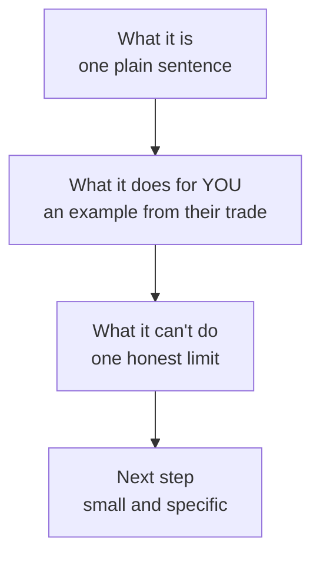

## Why this matters

Most first meetings are won or lost in the first minute. A builder who hears "agentic LLM workflows" switches off. A builder who hears "your enquiries answered in your words while you're on the tools, and you approve every one" leans in. This lesson turns the whole of Module 1 into something you can say over a cup of tea.

## Core explanation

### The 60-second structure

Use four beats. Each one takes about 15 seconds.

**A script you can adapt:**

> AI tools like ChatGPT are basically a very fast, well-read office junior that writes and reads for you. **(What it is)**
>
> For a firm like yours, that means an enquiry comes in at 9pm and there's a proper reply drafted in your words by the time you check your phone, or your voice note from site turns into a typed job sheet. **(For you)**
>
> It isn't magic and it does get things wrong, so nothing goes to a customer without you or your office approving it. **(Honest limit)**
>
> The easiest way to see if it's worth it is for me to set one up on your real enquiries for a fortnight and count the hours it saves. **(Next step)**

Notice what it leaves out: no "LLM", no "tokens", no "machine learning". You know all of it. The client doesn't need to.

### The builder test

Before you use any phrase with a client, ask yourself: *would a busy groundworker understand this on the first hearing, without me explaining it?* If not, translate it.

| Jargon | Say this instead |
|---|---|
| Large language model (LLM) | "The AI that reads and writes, like ChatGPT" |
| Prompt | "The instructions you give it" |
| Hallucination | "It sometimes makes things up confidently, so we check its work" |
| Context window | "How much it can read at once" |
| Training data | "What it learned from before it ever met you" |
| Automation / workflow | "A set of steps that runs by itself, like a programme of works" |
| Integration / API | "Connecting it to the software you already use" |
| AI agent | "AI that can carry out a few steps for you, with you signing off" |
| RAG / knowledge base | "It answers from your own documents, not from the internet" |
| Human in the loop | "You approve it before it goes out" |
| ROI | "What it saves you compared with what it costs" |

### Handling the three classic sceptic lines

- **"It's just hype."** *"A lot of it is. I only build things that save measurable hours, and we count them before and after."*
- **"It'll get things wrong."** *"It will sometimes. That's why it drafts and you approve. You stay in charge of everything that goes out."*
- **"We're too small for AI."** *"Small firms gain the most, because there's no office team to absorb the admin. It's usually the owner doing it at 10pm."*

Module 12 covers the full set of objections, with practice role-plays.

<Callout type="trades">
Construction analogies land well because they are true to how the systems work: an **automation** is a sequence on a programme of works; **AI drafting with approval** is a junior estimator whose quotes you sign off; **giving AI your documents** is a site induction.
</Callout>

## Worked example: Mullins Groundworks

*Fictional business; dialogue and figures are an illustrative example.*

Gary Mullins runs a nine-person groundworks firm in Essex. He agreed to "ten minutes, no sales pitch" at a networking breakfast and opened with: *"My nephew showed me ChatGPT. It wrote a poem about a digger. What use is that to me?"*

The consultant skipped the technology entirely: *"Fair. Poems are no use. How do your quotes get written at the moment?"* Gary: *"I do them Sunday nights. About six a week, an hour each."* The consultant then used the four beats: a fast office junior → it turns your site notes into a draft quote in your wording → it gets prices wrong if you let it guess, so your price list is the only source and you check every one → *"Send me three old quotes and the notes behind them, and I'll show you next week what it would have drafted."*

**Outcome (illustrative):** the demo used Gary's real notes, and the drafts needed about 15 minutes of editing each, against an hour from scratch. That is roughly 4–5 Sunday-night hours back each week. Gary booked a paid discovery session. What won him over wasn't the technology. It was being spoken to in his terms, with an honest limit, and a test on his own work.

## Tools

<Callout type="changes" title="Changes fast: checked 15 November 2026">
Voice features and their free-tier limits change often. Check what the free versions currently include.
</Callout>

You need no special tools to explain AI, but you can practise with one:

| Tool | Use for practice | Approximate UK cost 🔄 |
|---|---|---|
| **Voice mode** in ChatGPT, Claude or Gemini (Gemini Live) mobile apps | Speak your 60-second explanation and have the AI play a sceptical owner who talks back | Free tiers include voice, with usage limits; paid plans about £18–£20/month |
| **Your phone's voice recorder** | Record your pitch, play it back and time it | Free |

## Hands-on exercise

<Exercise minutes={5} title="Write it, say it, get pushback">

1. **Write (2 minutes).** Using the four beats, write your own 60-second explanation for a trade you know well, such as roofers, electricians or kitchen fitters. Use one example from that trade.
2. **Say it (1 minute).** Record yourself reading it and time it. Cut anything that takes it past 70 seconds.
3. **Get pushback (2 minutes).** Open voice mode in an AI app and say:

<PromptBox text={"Play a sceptical, busy roofing contractor called Dave who has been burned by tech salesmen before. I'm going to explain AI to you in 60 seconds. Reply in character with one blunt objection, then wait for my answer. Keep your replies short."} />

**Expected result:** a 60-second explanation with no jargon from the table above, one real trade example, one honest limit and one small next step, plus a note of the objection "Dave" raised and how you would answer it better next time.

</Exercise>

## Common mistakes

1. **Leading with technology.** Start with *their* problem, not with how AI works.
2. **Over-promising.** "It does everything automatically" sounds great until the first mistake. Always include the honest limit.
3. **Using jargon to sound expert.** It does the opposite: it sounds like a salesman hiding something.
4. **Ending without a next step.** Finish with something small and specific, such as a test on their real enquiries.

## Key takeaways

- Use the four beats: **what it is → what it does for them → one honest limit → a small next step**.
- Pass the **builder test**: translate every technical term into everyday words.
- Trade analogies (programme of works, junior estimator, site induction) are both persuasive and accurate.
- Demos on the client's **own work** convince far more than any explanation.
